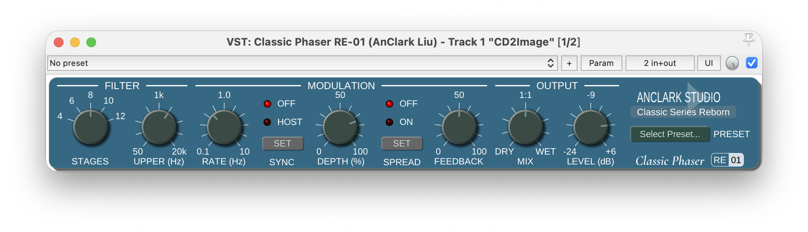

# Classic Phaser RE-01

Classic Phaser RE-01 is a reverse-engineered recreation of the **Kjaerhus Classic Phaser**, a free studio-quality phaser from Kjaerhus Audio's Classic Series. The DSP algorithm has been rebuilt faithfully from the original binary and is presented with a modern, RE-04-style interface — so the classic phaser sound can run on today's 64-bit DAWs and operating systems.



## Background

Classic Phaser was part of the Classic Series by Kjaerhus Audio, a Danish company that developed popular free audio plugins in the early 2000s (the original binary identifies itself as "Classic Phaser v1.03 by Kjaerhus Audio"). The series became well known for its clean sound and simple, attractive panels, but it was discontinued in the early 2010s, leaving the plugins unavailable to modern users.

Parts of the Classic Series were bundled with commercial DAWs such as Acoustica Mixcraft — but only on Windows, and only as 32-bit VST2. Users of 64-bit-only DAWs and non-Windows platforms were left out.

In 2026, I (AnClark Liu) reverse-engineered the original plugin to bring it back to life. The result is this open-source implementation: the DSP is reconstructed instruction-by-instruction from the original binary, while the interface follows the style established by Classic Reverb RE-04.

## Features

- **Faithful DSP**: the per-block coefficient update (`FUN_00483d5c`) and the per-sample core (`FUN_00484158`) of the original DLL, rebuilt statement-by-statement — see the next section.
- **The original nine parameters**: Stages, Upper, Rate, Sync., Depth, Spread, Feedback, Mix, Level.
- **Tempo sync**: the LFO can lock to the host tempo, including a phase re-seed to the song position on every block (not just frequency locking).
- **Modernized classic panel**: sectioned layout with scale-marked knobs, LED switches, and the preset manager of the Classic RE series.
- **15 factory presets**, with genre-inspired settings at the front of the bank (70s rock, disco, J-Pop, EDM, spatial, experimental) followed by a general-purpose ladder.
- **Multi-platform**: Windows, macOS and Linux.
- **Multiple plugin formats**: VST 2.4, VST3, CLAP, and optional JACK standalone.
- Preset management with save/load, import/export (JSON).

## DSP implementation

The algorithm was recovered from `prototype/Classic Phaser.dll` using Ghidra decompilation, and every statement was then verified against the machine code with `objdump` disassembly. All numeric constants (x87 80-bit immediates and data-section floats) are reproduced bit-exactly as C++ hex literals in `src/Defines.h`.

Two functions make up the DSP:

| Original | Role | Our code |
|---|---|---|
| `FUN_00483d5c` | parameters → coefficients / LFO rate / phase seed, called once per `processReplacing()` block | `ClassicPhaserPlugin::updateCoefficients()` |
| `FUN_00484158` | per-sample processing | `ClassicPhaserPlugin::run()` |

Signal path, sample by sample:

1. **Input dither** — RandExt (`0x402C08`): `state = state·0x08088405 + 1`, noise = `6e-8 · (rand − 0.5)`, the same value added to both channels.
2. **Input accumulation** — `x = in + dither + feedback · y_prev` (the feedback-scaled chain output of the previous sample).
3. **LFO** — a 32-bit phase accumulator (`phase += (int)(2³²·rate/sr)`), sampled as a sine every 20 samples and linearly interpolated between the two most recent values: `0.5 + 0.5·sin(2π/2³² · phase)`.
4. **Per-sample coefficients** — the interpolated modulation `m` blends the two sweep endpoints: `x = (1−m)·tan(π·fLow/sr) + m·tan(π·fHigh/sr)`, then `a = x/(1+x)`, `c = (1−x)/(1+x)`. With **Spread** enabled, the right channel uses the same formulas with the blend weights reversed, so the two channels sweep in opposite directions.
5. **Allpass cascade** — 4 to 12 first-order allpass stages per channel: `v = x − d·c`, `y = (d·(−a) + v·a) − 0.5·x`, `y *= 2`, `d ← v`. (The cascade is an allpass: constant magnitude, phase shift only — the characteristic "whoosh".)
6. **Mix and level** — `out = chain·(0.063096·Mix·31.6226^Level) + in·(0.063096·(1−Mix)·31.6226^Level)`, i.e. ≈ −24 dB + 30·Level dB of output trim around the dry/wet blend.
7. **Feedback** — `chain_out · 0.98 · FeedbackNorm` feeds back into step 2 (gain reaches 0.98 at 100 %, i.e. just below self-oscillation).

Sweep endpoints: `fHigh = 50·400^UpperNorm` (50 Hz … 20 kHz) and `fLow = fHigh^(1−Depth)`, reaching 50 Hz at Depth = 100 %.

**Tempo sync**: with `Sync > 0.5` and a host-provided tempo, the LFO rate becomes `rateHz = syncVal · BPM / 7680`, where `syncVal = 2^(int)(8·RateNorm)` shifted by a power-of-two bucket of `int(768/BPM)` — the Rate knob selects one of nine discrete divisions while the rate stays proportional to the project tempo (quantized to octaves, exactly like the original, quirks included). In addition, the phase accumulator is re-seeded to `increment · samplePos` at every block, which anchors the LFO to the song position: scrubbing or changing tempo re-aligns the modulation phase. If the host provides no tempo, the plugin silently falls back to the free-run rate, as the original does.

### Parameters

| # | Name | Range | Default | Meaning |
|---|---|---|---|---|
| 0 | Stages | 4 … 12 (even) | 8 | number of allpass stages (4/6/8/10/12) |
| 1 | Upper | 50 … 20000 Hz | 2000 | upper limit of the sweep |
| 2 | Rate | 0.1 … 10 Hz | 0.5 | free-run LFO rate; selects the division when Sync is on |
| 3 | Sync. | off / on | off | lock the LFO to the host tempo |
| 4 | Depth | 0 … 100 % | 75 | sweep depth — lower limit = `fHigh^(1−Depth)`, down to 50 Hz |
| 5 | Spread | off / on | off | right channel modulated in reverse (stereo width) |
| 6 | Feedback | 0 … 100 % | 50 | feedback amount (`0.98 · F/100`) |
| 7 | Mix | 0 … 100 % | 50 | dry / wet balance |
| 8 | Level | −24 … +6 dB | 0 | output level |

### Faithfulness and deliberate deviations

- **Bit-exact constants**: every scalar used by the DSP was extracted from the DLL and verified against the original bytes; operation order and rounding points (one rounding per float32 store, like the x87 register chain) match the binary.
- **x87 vs. IEEE double**: true bit-exactness off x86 is impossible — the original's 80-bit intermediates and `fsin`/`fcos` have no IEEE-double equivalent. Formulas, constants and rounding points are identical; residuals are ~1e-16 relative, which can only flip a float32 in rare near-tie cases.
- **Output soft clip** (`CLASSIC_PHASER_OUTPUT_SOFT_CLIP`): a tanh limiter at +5 dBFS, on by default. The original has no output protection; disable the flag in `src/Defines.h` for the unmodified behaviour.
- **Physical parameter units**: parameters are exposed in Hz / % / dB (RE-04 convention) and mapped back to the original's normalised 0…1 storage with exact inverse formulas inside `updateCoefficients()`.
- The silence gate used by the Reverb RE series is intentionally **not** applied here — the phaser's entire state is 2×12 floats plus two accumulators, so idle CPU cost is negligible.

## Presets

The factory bank ships 15 presets. The first six are genre-inspired — `70s Stomp`, `Disco Nights`, `Tokyo Shimmer`, `Drop Sweep`, `Head Wrap`, `Warp Zone` — covering classic rock phase, disco shimmer, J-Pop sparkle, tempo-synced EDM sweeps, slow stereo wrapping, and experimental near-self-oscillation. They are followed by a general-purpose ladder ordered by increasing intensity (`Soft Vertex` … `Jet Stream`). User presets are stored as JSON in the per-user data directory and can be imported/exported as files.

## How to Compile

To compile Classic Phaser RE-01 you need:

- CMake (3.15 or higher)
- A C++ compiler with C++17 support (GCC, Clang, MSVC)

1. Clone the repository:

   ```bash
   git clone --recurse-submodules https://github.com/AnClark/ClassicPhaser-RE01.git
   cd ClassicPhaser-RE01
   ```

2. Configure and build:

   ```bash
   cmake -S . -B build -DCMAKE_BUILD_TYPE=Release
   cmake --build build
   ```

3. The compiled plugins will be located in the `build/bin` directory.

## Testing

A standalone behavioural test exercises the real DSP sources through a harness (stage-count mapping, sweep endpoints, exact dry path, full-wet DC gain, LFO period, sync fallback, level mapping):

```bash
c++ -std=c++17 -O1 -I src -I dpf/distrho -I build \
    tests/dsp_behavior_test.cpp src/CoreDSP.cpp src/ClassicPhaserPlugin.cpp \
    dpf/distrho/src/DistrhoPlugin.cpp -o dsp_behavior_test \
  && ./dsp_behavior_test
```

## Build and Package

Classic Phaser RE-01 uses CMake for building and CPack for packaging. The package format is selected automatically for the target platform:

- Windows and Linux: ZIP archive
- macOS: CPack Bundle DMG containing the plugin app bundles

```bash
cmake -S . -B build -DCMAKE_BUILD_TYPE=Release
cmake --build build --target package
```

The package is written to the `build` directory and contains the VST2, VST3 and CLAP bundles.

### Cross-build for Windows on Linux / macOS

The `Makefile.win32_cross.mk` pipeline cross-compiles the plugin for Windows and delegates packaging to CPack:

```
make -f Makefile.win32_cross.mk
```

The cross-build pipeline requires a MinGW-w64 C++ compiler, CMake, Ninja, CPack, ccache, Git and sed.

## Tools used

- **Ghidra**: for decompiling the original plugin's binary to reconstruct its DSP behaviour.
- **objdump**: for instruction-level verification of the two DSP functions and extraction of the x87/data-section constants.
- **MiMo v2.6 Flash**: for researching the decompiled/disassembled code and assisting development.

## DISCLAIMER

This project is a reverse-engineering effort and is not affiliated with Kjaerhus Audio or any of its former employees. The original Classic Phaser was developed by Kjaerhus Audio; this implementation is an independent recreation based on the original's behavior and sound.

This project is not affiliated with Acoustica LLC or other manufacturers that included Classic Phaser in their products.

The Kjaerhus logo in the plugin UI is used under fair use for non-commercial purposes, to describe where the original Classic Phaser plugin came from.

## License

This project is licensed under the GPLv3 License. See the [LICENSE](LICENSE) file for details.

Components in `widgets/imgui-ext` and `widgets/imgui-knobs-mod` are licensed under the MIT License, while `widgets/dpf-imgui` is licensed under the ISC License. See the respective LICENSE files in those directories for details.
